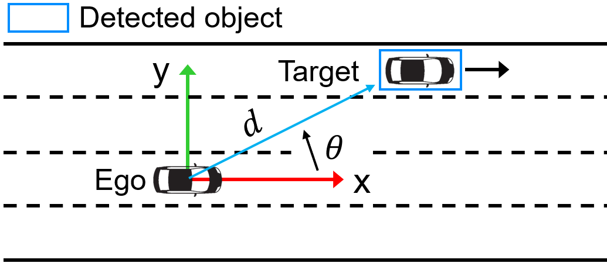

# Open Perception Error Models for Connected and Autonomous Driving Research
This repository contains the first set of openly available PEMs for connected and autonomous driving research. The PEMs model the following key perception metrics:
- Object detection probability: probability that a target object is detected by the ego-vehicle.
- Longitudinal position estimation error: absolute difference between...see ego-vehicle's coordinate system in the figure below. 
- Lateral position estimation error: 
- Heading estimation error: absolute difference
- Existence probability: confidence of the object detection algorithm in the actual existence of a detected object.



1. Shifted exponential function: $\sqrt{3x-1}+(1+x)^2$
2. Linear function: 
3. 
<div align="center">

</div>

PEMs are designed as lightweight statistical models calibrated on a synthetic dataset of perception metrics collected comparing the ground-truth obejct states provided by CARLA-SUMO co-simulations and the output of the perception of an Autopware-based ego-vehicle. 

We release PEMs for three different types of LiDAR. 

You can find additional details about the methodology and the PEMs by reading our paper. If you use these PEMs, please cite this work: 
```
function test() {
  console.log("notice the blank line before this function?");
}
```

| First Header  | Second Header |
| ------------- | ------------- |
| Content Cell  | Content Cell  |
| Content Cell  | Content Cell  |

All metrics are measured at both the detection and the validation stage of Autoware's perception module. 


Do not try to generate errors for distances larger than the detection range, i.e., the distance at which the object detection probability drops to zero. The errors are not defined there. 

