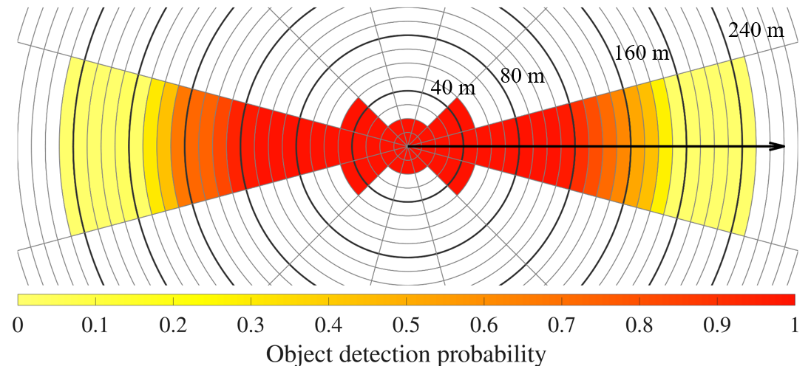

# Open Perception Error Models (PEMs)   for Connected and Autonomous Driving Research [](https://arxiv.org/abs/XXXX.XXXXX)
This repository contains the first set of openly available PEMs for connected and autonomous driving research. The released PEMs model the following perception metrics:
- **Object detection probability:** probability that a target object is detected by the ego-vehicle.
- **Longitudinal position estimation error:** absolute difference between the target object’s ground truth and estimated relative position on the x-axis of the ego-vehicle’s right-hand coordinate system (shown in Fig. 1 below).
- **Lateral position estimation error:** absolute difference between the target object’s ground truth and estimated relative position on the y-axis of the ego-vehicle’s right-hand coordinate system (shown in Fig. 1 below).
- **Heading estimation error:** absolute difference between the target object’s ground truth and estimated relative headings. The target object’s relative heading represents its direction of travel with respect to the ego-vehicle (see Fig. 1). For example, a relative heading of 0° indicates that the target object is traveling in the same direction as the ego vehicle.
- **Existence probability:** confidence of the object detection algorithm in the actual existence of a detected object.


<div align="center">
  
  <br>
  <b>Fig. 1. Ego-vehicle's coordinate system</b>
  <br>
  <br>
</div>

The released PEMs are designed as lightweight statistical models calibrated on a synthetic dataset of perception metrics collected comparing the ground-truth obejct states provided by CARLA-SUMO co-simulations and the output of the perception module of an Autoware-based vehicle. Specifically, we release PEMs for both the **detection** and the **validation** stage of Autoware's perception module, considering three commercially available rooftop LiDAR sensors from [Ouster](https://ouster.com/products/hardware/os2-lidar-sensor): the OS2-128, OS2-64, and OS1-64.

You can find additional details about the PEMs and the employed methodology in our [paper](https://arxiv.org/abs/XXXX.XXXXX). If you use these PEMs, please cite our work: 
```bibtex
@article{lusvarghi2026pems,
  title   = {Open Perception Error Models for Connected and Autonomous Driving Research},
  author  = {L. Lusvarghi, M. Sepulcre, J. Gozalvez, S. Alacid Riquelme and J. Torres Gisbert},
  year    = {2026},
  journal = {arXiv preprint arXiv:XXXX.XXXXX}
}
```
## Download and Usage
### Download

Clone the repository:

```bash
git clone https://github.com/umh-networked-systems-lab/PEMs4CAD.git
cd PEMs4CAD
```

or click **Code → Download ZIP** at the top of this page. The repository contains two folders with equivalent implementations of all PEMs:

| Folder | Contents |
|---|---|
| `Matlab/` | MATLAB implementation (`PEMs_Example.m` plus one function per metric) |
| `Python/` | Python 3 implementation (`PEMs_Example.py` and the `pems.py` module with all metrics) |

### Running the examples

**MATLAB.** Open MATLAB, change to the `Matlab` folder, and run:

```matlab
PEMs_Example
```

**Python.** The Python version requires Python 3 and NumPy:

```bash
pip install numpy
cd Python
python3 PEMs_Example.py
```

Both examples do the same thing: they compute the detection probability of a target object, draw a random detection outcome from it, and, if the object is detected, sample its position error, heading error, and existence probability. A typical output looks like this:

```
Object detected? 1 (1 = yes, 0 = no)
X: -0.17 m, Y: 0.08, heading: 4.4°, existence probability: 0.66
```

Since the errors are sampled from statistical distributions, the output changes at every run.

### Configuring the PEMs

Open `PEMs_Example.m` or `PEMs_Example.py` and edit the settings at the top of the script:

```python
lidar_type = "OS2-128"          # "OS2-128", "OS2-64" or "OS1-64"
perception_stage = "detection"  # "detection" or "validation"
distance = 100                  # meters
angle = 0                       # degrees
```

`distance` and `angle` are the distance and angle of the target object relative to the ego-vehicle's coordinate system shown in Fig. 1. **The default and recommended LiDAR is the OS2-128.**

Please note that the examples are provided for illustrative purposes only: they show how to use the PEMs to model the impact of the object detection probability as well as object estimation errors on the estimated position of a target object. **You are welcome to reuse the MATLAB and Python functions to integrate the PEMs into your own scripts and simulation frameworks.**

### Available functions

| Metric | MATLAB | Python | Returns |
|---|---|---|---|
| Object detection probability | `getObjectDetectionProbability` | `get_object_detection_probability` | probability in [0, 1] |
| Longitudinal and lateral position errors | `getPositionEstimationError` | `get_position_estimation_error` | `x_error`, `y_error` (m) |
| Heading estimation error | `getHeadingEstimationError` | `get_heading_estimation_error` | `heading_error` (°) |
| Existence probability | `getExistenceProbability` | `get_existence_probability` | probability in [0, 1] |

All functions take the same four inputs: `(lidar_type, perception_stage, distance, angle)`. For example, in MATLAB:

```matlab
p = getObjectDetectionProbability("OS2-128", "detection", 100, 0);
[x_error, y_error] = getPositionEstimationError("OS2-128", "detection", 100, 0);
heading_error = getHeadingEstimationError("OS2-128", "detection", 100, 0);
existence_prob = getExistenceProbability("OS2-128", "detection", 100, 0);
```

and in Python:

```python
from pems import *

p = get_object_detection_probability("OS2-128", "detection", 100, 0)
x_error, y_error = get_position_estimation_error("OS2-128", "detection", 100, 0)
heading_error = get_heading_estimation_error("OS2-128", "detection", 100, 0)
existence_prob = get_existence_probability("OS2-128", "detection", 100, 0)
```
Please note that `getObjectDetectionProbability` (and its Python counterpart) returns a detection probability. To decide whether the object is detected, you need to draw a uniform random number and compare it with this detection probability, as done in the examples.

### Domain of the PEMs

Fig. 2 shows the 2D domain of the object detection probability, i.e., the set of target object's relative positions (distance, angle) for which the PEM's object detection probability is defined and should be used. The PEMs are **not defined and, therefore, should not be used outside of this domain**. If you want to keep things simple, always set the target object's angle ($\theta$ in Fig. 1) to 0°, since this is the configuration where the domain has the largest extension.

<div align="center">
  
  <br>
  <b>Fig. 2. Object detection probability domain</b>
</div>

<br>

For each LiDAR type (OS2-128, OS2-64, OS1-64) and perception stage (detection or validation), the position estimation errors, heading estimation error, and existence probability can be applied only to detected objects. If you try to model these metrics for target objects' positioned beyond the **detection range** of a LiDAR-perception stage configuration you will get an error. The detection range is the distance at which the object detection probability drops to practically zero. The detection range of the various LiDAR-perception stage configurations is reported below:

<div align="center">
  <b>Table 1. Detection range of each LiDAR-perception stage configuration.</b>
<table>
  <thead>
    <tr>
      <th align="center">LiDAR</th>
      <th align="center">Detection stage</th>
      <th align="center">Validation stage</th>
    </tr>
  </thead>
  <tbody>
    <tr><td align="center">OS2-128</td><td align="center">240 m</td><td align="center">170 m</td></tr>
    <tr><td align="center">OS2-64</td><td align="center">190 m</td><td align="center">160 m</td></tr>
    <tr><td align="center">OS1-64</td><td align="center">120 m</td><td align="center">100 m</td></tr>
  </tbody>
</table>
</div>


## PEMs Parameters
The PEMs are lightweight statistical models calibrated on a synthetic dataset of perception metrics. Each metric is modeled as either a Bernoulli random variable (object detection probability) or a Gaussian random variable (position and heading estimation errors, and existence probability). The defining parameters of these distributions (success probability $p$, mean $\mu$, and standard deviation $\sigma$) are obtained by fitting the collected data.

As higlighted in the [paper](https://arxiv.org/abs/XXXX.XXXXX), for a given ego-target distance, all metrics show similar values across the directions (angles, $\theta$) where they are defined. We therefore approximate their parameters with 1D functions of the ego-target distance $d$ (in meters), chosen among the following:

1. Exponential function: $f_{\mathrm{exp}}(d) = e^{-(ad)^b}$
2. Shifted exponential function: $f_{\mathrm{shift\text{-}exp}}(d) = a + e^{(bd)^c}$
3. Linear function: $f_{\mathrm{lin}}(d) = ad + b$

The parameters of these functions are fitted on the collected data and reported in the tables below for all LiDAR-perception stage configurations. 

<div align="center">
<b>Table I. OS2-128 LiDAR, detection stage.</b>
<table>
  <thead>
    <tr>
      <th align="left">Metric</th>
      <th align="center">Distribution</th>
      <th align="center">Function</th>
      <th align="center">Parameters</th>
    </tr>
  </thead>
  <tbody>
    <tr>
      <td align="left">Object detection probability</td>
      <td align="center">Bernoulli, <i>p</i></td>
      <td align="center">Exponential</td>
      <td align="center">a = 0.0057, b = 7.05</td>
    </tr>
    <tr>
      <td align="left" rowspan="2">Longitudinal est. error</td>
      <td align="center">Gaussian, <i>μ</i></td>
      <td align="center">Shifted exponential</td>
      <td align="center">a = −0.71, b = 0.0051, c = 10</td>
    </tr>
    <tr>
      <td align="center">Gaussian, <i>σ</i></td>
      <td align="center">Shifted exponential</td>
      <td align="center">a = −0.9137, b = 0.004486, c = 6.108</td>
    </tr>
    <tr>
      <td align="left" rowspan="2">Lateral est. error</td>
      <td align="center">Gaussian, <i>μ</i></td>
      <td align="center">Linear</td>
      <td align="center">a = 0.0005, b = 0.0335</td>
    </tr>
    <tr>
      <td align="center">Gaussian, <i>σ</i></td>
      <td align="center">Linear</td>
      <td align="center">a = 0, b = 0.0988</td>
    </tr>
    <tr>
      <td align="left" rowspan="2">Heading est. error</td>
      <td align="center">Gaussian, <i>μ</i></td>
      <td align="center">Shifted exponential</td>
      <td align="center">a = 0.6258, b = 0.0063, c = 2.2688</td>
    </tr>
    <tr>
      <td align="center">Gaussian, <i>σ</i></td>
      <td align="center">Shifted exponential</td>
      <td align="center">a = 0.0137, b = 0.0082, c = 2.3423</td>
    </tr>
    <tr>
      <td align="left" rowspan="2">Existence probability</td>
      <td align="center">Gaussian, <i>μ</i></td>
      <td align="center">Linear</td>
      <td align="center">a = −0.0020, b = 0.8016</td>
    </tr>
    <tr>
      <td align="center">Gaussian, <i>σ</i></td>
      <td align="center">Linear</td>
      <td align="center">a = 0, b = 0.0667</td>
    </tr>
  </tbody>
</table>
</div>

<br>

<div align="center">
<b>Table II. OS2-128 LiDAR, validation stage.</b>
<table>
  <thead>
    <tr>
      <th align="left">Metric</th>
      <th align="center">Distribution</th>
      <th align="center">Function</th>
      <th align="center">Parameters</th>
    </tr>
  </thead>
  <tbody>
    <tr>
      <td align="left">Object detection probability</td>
      <td align="center">Bernoulli, <i>p</i></td>
      <td align="center">Exponential</td>
      <td align="center">a = 0.0081, b = 9.65</td>
    </tr>
    <tr>
      <td align="left" rowspan="2">Longitudinal est. error</td>
      <td align="center">Gaussian, <i>μ</i></td>
      <td align="center">Linear</td>
      <td align="center">a = 0, b = 0.3</td>
    </tr>
    <tr>
      <td align="center">Gaussian, <i>σ</i></td>
      <td align="center">Linear</td>
      <td align="center">a = 0, b = 0.0871</td>
    </tr>
    <tr>
      <td align="left" rowspan="2">Lateral est. error</td>
      <td align="center">Gaussian, <i>μ</i></td>
      <td align="center">Linear</td>
      <td align="center">a = 0.0005, b = 0.0318</td>
    </tr>
    <tr>
      <td align="center">Gaussian, <i>σ</i></td>
      <td align="center">Linear</td>
      <td align="center">a = 0.0008, b = 0.0296</td>
    </tr>
    <tr>
      <td align="left" rowspan="2">Heading est. error</td>
      <td align="center">Gaussian, <i>μ</i></td>
      <td align="center">Shifted exponential</td>
      <td align="center">a = 0.5632, b = 0.0042, c = 1.7398</td>
    </tr>
    <tr>
      <td align="center">Gaussian, <i>σ</i></td>
      <td align="center">Shifted exponential</td>
      <td align="center">a = 0.1008, b = 0.0064, c = 1.9705</td>
    </tr>
    <tr>
      <td align="left" rowspan="2">Existence probability</td>
      <td align="center">Gaussian, <i>μ</i></td>
      <td align="center">Linear</td>
      <td align="center">a = −0.0016, b = 0.8403</td>
    </tr>
    <tr>
      <td align="center">Gaussian, <i>σ</i></td>
      <td align="center">Linear</td>
      <td align="center">a = 0.0003, b = 0.0371</td>
    </tr>
  </tbody>
</table>
</div>

<br>

<div align="center">
<b>Table III. OS2-64 LiDAR, detection stage.</b>
<table>
  <thead>
    <tr>
      <th align="left">Metric</th>
      <th align="center">Distribution</th>
      <th align="center">Function</th>
      <th align="center">Parameters</th>
    </tr>
  </thead>
  <tbody>
    <tr>
      <td align="left">Object detection probability</td>
      <td align="center">Bernoulli, <i>p</i></td>
      <td align="center">Exponential</td>
      <td align="center">a = 0.0079, b = 6.05</td>
    </tr>
    <tr>
      <td align="left" rowspan="2">Longitudinal est. error</td>
      <td align="center">Gaussian, <i>μ</i></td>
      <td align="center">Shifted exponential</td>
      <td align="center">a = −0.3164, b = 0.0012, c = 1.3490</td>
    </tr>
    <tr>
      <td align="center">Gaussian, <i>σ</i></td>
      <td align="center">Shifted exponential</td>
      <td align="center">a = −0.8982, b = 0.0071, c = 23.8104</td>
    </tr>
    <tr>
      <td align="left" rowspan="2">Lateral est. error</td>
      <td align="center">Gaussian, <i>μ</i></td>
      <td align="center">Linear</td>
      <td align="center">a = 0.0008, b = 0.0129</td>
    </tr>
    <tr>
      <td align="center">Gaussian, <i>σ</i></td>
      <td align="center">Linear</td>
      <td align="center">a = 0.0015, b = −0.0103</td>
    </tr>
    <tr>
      <td align="left" rowspan="2">Heading est. error</td>
      <td align="center">Gaussian, <i>μ</i></td>
      <td align="center">Shifted exponential</td>
      <td align="center">a = 1.1403, b = 0.0074, c = 215.8726</td>
    </tr>
    <tr>
      <td align="center">Gaussian, <i>σ</i></td>
      <td align="center">Shifted exponential</td>
      <td align="center">a = 0.6499, b = 0.0075, c = 125.0842</td>
    </tr>
    <tr>
      <td align="left" rowspan="2">Existence probability</td>
      <td align="center">Gaussian, <i>μ</i></td>
      <td align="center">Linear</td>
      <td align="center">a = −0.0031, b = 0.8410</td>
    </tr>
    <tr>
      <td align="center">Gaussian, <i>σ</i></td>
      <td align="center">Linear</td>
      <td align="center">a = 0.0011, b = −0.0396</td>
    </tr>
  </tbody>
</table>
</div>

<br>

<div align="center">
<b>Table IV. OS2-64 LiDAR, validation stage.</b>
<table>
  <thead>
    <tr>
      <th align="left">Metric</th>
      <th align="center">Distribution</th>
      <th align="center">Function</th>
      <th align="center">Parameters</th>
    </tr>
  </thead>
  <tbody>
    <tr>
      <td align="left">Object detection probability</td>
      <td align="center">Bernoulli, <i>p</i></td>
      <td align="center">Exponential</td>
      <td align="center">a = 0.0113, b = 6.1</td>
    </tr>
    <tr>
      <td align="left" rowspan="2">Longitudinal est. error</td>
      <td align="center">Gaussian, <i>μ</i></td>
      <td align="center">Linear</td>
      <td align="center">a = −0.0003, b = 0.7027</td>
    </tr>
    <tr>
      <td align="center">Gaussian, <i>σ</i></td>
      <td align="center">Linear</td>
      <td align="center">a = 0.0002, b = 0.0876</td>
    </tr>
    <tr>
      <td align="left" rowspan="2">Lateral est. error</td>
      <td align="center">Gaussian, <i>μ</i></td>
      <td align="center">Linear</td>
      <td align="center">a = 0.0008, b = 0.0123</td>
    </tr>
    <tr>
      <td align="center">Gaussian, <i>σ</i></td>
      <td align="center">Linear</td>
      <td align="center">a = 0.0009, b = 0.0188</td>
    </tr>
    <tr>
      <td align="left" rowspan="2">Heading est. error</td>
      <td align="center">Gaussian, <i>μ</i></td>
      <td align="center">Shifted exponential</td>
      <td align="center">a = 0.5290, b = 0.0081, c = 1.0384</td>
    </tr>
    <tr>
      <td align="center">Gaussian, <i>σ</i></td>
      <td align="center">Shifted exponential</td>
      <td align="center">a = −0.3466, b = 0.0097, c = 0.4994</td>
    </tr>
    <tr>
      <td align="left" rowspan="2">Existence probability</td>
      <td align="center">Gaussian, <i>μ</i></td>
      <td align="center">Linear</td>
      <td align="center">a = −0.0021, b = 0.8096</td>
    </tr>
    <tr>
      <td align="center">Gaussian, <i>σ</i></td>
      <td align="center">Linear</td>
      <td align="center">a = 0.0006, b = 0.0232</td>
    </tr>
  </tbody>
</table>
</div>

<br>

<div align="center">
<b>Table V. OS1-64 LiDAR, detection stage.</b>
<table>
  <thead>
    <tr>
      <th align="left">Metric</th>
      <th align="center">Distribution</th>
      <th align="center">Function</th>
      <th align="center">Parameters</th>
    </tr>
  </thead>
  <tbody>
    <tr>
      <td align="left">Object detection probability</td>
      <td align="center">Bernoulli, <i>p</i></td>
      <td align="center">Exponential</td>
      <td align="center">a = 0.0145, b = 7.1</td>
    </tr>
    <tr>
      <td align="left" rowspan="2">Longitudinal est. error</td>
      <td align="center">Gaussian, <i>μ</i></td>
      <td align="center">Shifted exponential</td>
      <td align="center">a = −0.2972, b = 0.0012, c = 15.8399</td>
    </tr>
    <tr>
      <td align="center">Gaussian, <i>σ</i></td>
      <td align="center">Shifted exponential</td>
      <td align="center">a = −0.9369, b = 0.0017, c = 1.3642</td>
    </tr>
    <tr>
      <td align="left" rowspan="2">Lateral est. error</td>
      <td align="center">Gaussian, <i>μ</i></td>
      <td align="center">Linear</td>
      <td align="center">a = 0.0009, b = 0.0136</td>
    </tr>
    <tr>
      <td align="center">Gaussian, <i>σ</i></td>
      <td align="center">Linear</td>
      <td align="center">a = 0.0015, b = 0.0050</td>
    </tr>
    <tr>
      <td align="left" rowspan="2">Heading est. error</td>
      <td align="center">Gaussian, <i>μ</i></td>
      <td align="center">Shifted exponential</td>
      <td align="center">a = 0.8533, b = 0.0096, c = 1.9933</td>
    </tr>
    <tr>
      <td align="center">Gaussian, <i>σ</i></td>
      <td align="center">Shifted exponential</td>
      <td align="center">a = −0.2651, b = 0.0133, c = 0.9798</td>
    </tr>
    <tr>
      <td align="left" rowspan="2">Existence probability</td>
      <td align="center">Gaussian, <i>μ</i></td>
      <td align="center">Linear</td>
      <td align="center">a = −0.0052, b = 0.8484</td>
    </tr>
    <tr>
      <td align="center">Gaussian, <i>σ</i></td>
      <td align="center">Linear</td>
      <td align="center">a = 0.0008, b = 0.0232</td>
    </tr>
  </tbody>
</table>
</div>

<br>

<div align="center">
<b>Table VI. OS1-64 LiDAR, validation stage.</b>
<table>
  <thead>
    <tr>
      <th align="left">Metric</th>
      <th align="center">Distribution</th>
      <th align="center">Function</th>
      <th align="center">Parameters</th>
    </tr>
  </thead>
  <tbody>
    <tr>
      <td align="left">Object detection probability</td>
      <td align="center">Bernoulli, <i>p</i></td>
      <td align="center">Exponential</td>
      <td align="center">a = 0.018, b = 4.8</td>
    </tr>
    <tr>
      <td align="left" rowspan="2">Longitudinal est. error</td>
      <td align="center">Gaussian, <i>μ</i></td>
      <td align="center">Linear</td>
      <td align="center">a = 0.0017, b = 0.6516</td>
    </tr>
    <tr>
      <td align="center">Gaussian, <i>σ</i></td>
      <td align="center">Linear</td>
      <td align="center">a = −0.0003, b = 0.0868</td>
    </tr>
    <tr>
      <td align="left" rowspan="2">Lateral est. error</td>
      <td align="center">Gaussian, <i>μ</i></td>
      <td align="center">Linear</td>
      <td align="center">a = 0.0010, b = 0.0120</td>
    </tr>
    <tr>
      <td align="center">Gaussian, <i>σ</i></td>
      <td align="center">Linear</td>
      <td align="center">a = 0.0008, b = 0.0237</td>
    </tr>
    <tr>
      <td align="left" rowspan="2">Heading est. error</td>
      <td align="center">Gaussian, <i>μ</i></td>
      <td align="center">Shifted exponential</td>
      <td align="center">a = 1.0038, b = 0.0133, c = 166.8569</td>
    </tr>
    <tr>
      <td align="center">Gaussian, <i>σ</i></td>
      <td align="center">Shifted exponential</td>
      <td align="center">a = −0.49, b = 0.0174, c = 0.6870</td>
    </tr>
    <tr>
      <td align="left" rowspan="2">Existence probability</td>
      <td align="center">Gaussian, <i>μ</i></td>
      <td align="center">Linear</td>
      <td align="center">a = −0.0058, b = 0.8607</td>
    </tr>
    <tr>
      <td align="center">Gaussian, <i>σ</i></td>
      <td align="center">Linear</td>
      <td align="center">a = 0.0007, b = 0.0242</td>
    </tr>
  </tbody>
</table>
</div>

<br>